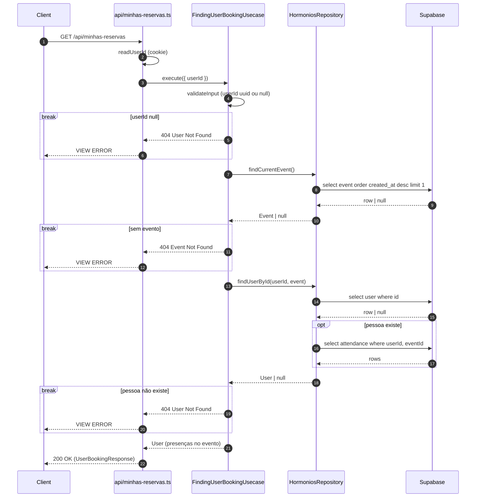

# Diagrama de sequência a partir do código

Entrada: a classe do usecase (`FindingUserUsecase`) ou a rota (`GET /api/minhas-reservas`).
Saída: um `sequenceDiagram` fiel ao código, que mostra cada ida ao banco e à API externa.

## Passo 1 — Seguir o código

1. Ache a rota em `api/` que chama o usecase (`Envolviment.make(<Usecase>.token)`). Se não houver
   rota, quem está na ponta é o usecase que chama este.
2. Leia `execute` e `_execute` e siga os métodos privados na ordem em que são chamados.
3. Abra cada método de repo (`repos/supabase/HormoniosRepository.ts`, `repos/transicionais/`) e
   conte as chamadas que ele faz ao client. Cada `supabaseClient.query` é uma ida ao Supabase. Um
   método de repo que chama outro aparece como as duas idas.
4. Não invente nada que o código não faz. Ramo que o código não deixa claro vai para as Perguntas.

## Passo 2 — Participantes

Da esquerda para a direita, com o nome real:

`Client` → a rota (`api/<arquivo>.ts`) → o usecase → os usecases que ele chama → os repos →
`Supabase` / `Transicionais`.

- Use um alias curto com o nome legível: `participant UC as FindingUserUsecase`.
- Entra só quem aparece no fluxo.

- **Usecase chamado por outro aparece fechado:** só a chamada e o retorno, sem abrir as idas ao
  repo dele. O detalhe fica no bloco próprio desse usecase, e o **Desenho** de quem chama linka a
  etapa ("O ensaio vem de "Ver o ensaio com quem vai", acima").
- **Exceção: `IdentifyingUserUsecase`** (autenticação). Não ganha raia: vira um passo de quem
  chama, `UC->>UC: validateIdentifier (IdentifyingUserUsecase)`. O detalhe fica na doc própria
  (`docs/usecases/autenticacao.md`).

## Passo 3 — Mensagens

- **Chamada** (`->>`): o nome do método e os argumentos que importam:
  `findUserById(userId, event)`.
- **Retorno** (`-->>`): o tipo de domain: `User | null`, `Attendance[]`.
- **Ida ao Supabase:** o que a query faz, curto: `select attendance where userId, eventId`.
- **Cálculo em memória** (validação, `withAttendances`, mapper) é mensagem do participante para ele
  mesmo: `UC->>UC: validateInput`.

## Passo 4 — Ramos e erros

- **Erro que encerra o fluxo vira `break`.** Dentro dele, o status e a mensagem do `AppError`
  voltam até a ponta: `UC-->>APP: 404 User Not Found` e `APP-->>C: VIEW ERROR`. O caminho feliz
  segue depois do `end`, sem aninhar.
- **Ramo que se fecha e o fluxo continua** vira `opt`, ou `alt` / `else` quando os dois lados fazem
  coisas diferentes.
- **Retorno antecipado de sucesso** também vira `break`: `break mesmo email`.

## Passo 5 — Saída

1. **Premissas:** curtas. Por exemplo, o que foi simplificado ou qual erro genérico ficou de fora.
2. O bloco ` ```mermaid `.
3. **Perguntas:** só se houver ramo ambíguo.

Quando o diagrama vai para a doc de usecase (`docs/usecases/<dominio>.md`), ele é o **Desenho** do
bloco e não conta no limite de 20 linhas.

## Regras de renderização

- Comece com `sequenceDiagram` e `autonumber`.
- Todo `break`, `alt` e `opt` tem `end`.
- Sem `activate` / `deactivate`.
- Nada de `;` ou `#` nos rótulos.

## Exemplo de referência

`FindingUserBookingUsecase` — `GET /api/minhas-reservas`:


