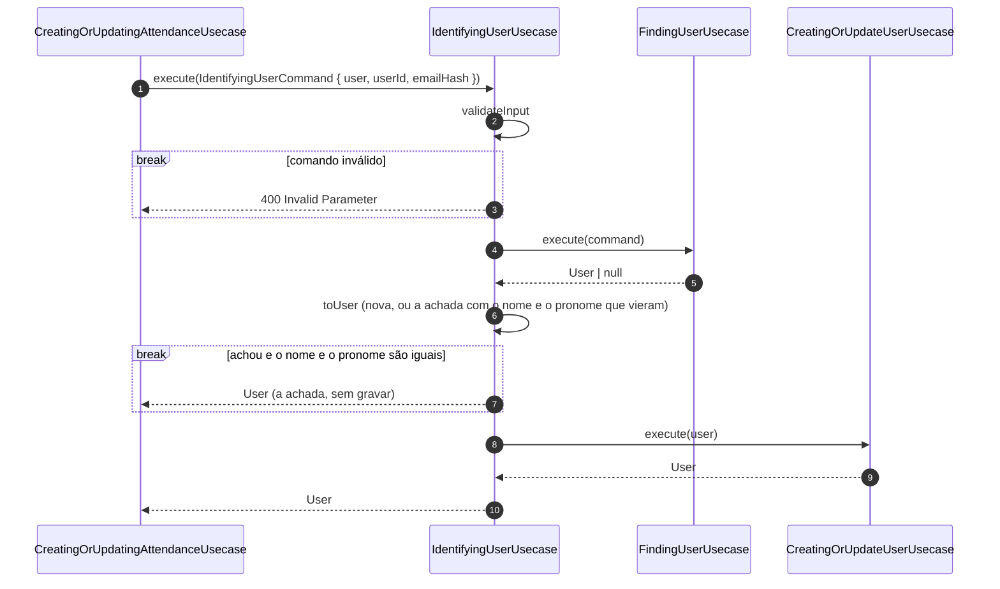

# Autenticação

> Atualizado em 2026-10-30. Quem a pessoa é, sem login: o aparelho e o e-mail. Nos diagramas dos
> outros usecases, este aparece fechado; o detalhe fica aqui.

## Identificar quem está reservando (IdentifyingUserUsecase) — sem rota

**Telas.** Nenhuma diretamente: roda na confirmação de presença (Presença e o começo da folha de
reserva quando a pessoa não é reconhecida).

**Contexto.** Antes de confirmar a presença, o sistema precisa saber quem é a pessoa, e gravar só o
que mudou.

**Desenho.** Achar a pessoa é "Descobrir quem está reservando", e gravar é "Gravar a pessoa",
os dois em [`reservas.md`](reservas.md).

**Decisão.**
- A pessoa certa é a do aparelho, se o e-mail (completo, ou mascarado com a confirmação) bate;
  senão, a do e-mail; senão, uma pessoa nova.
- Só grava e envia ao Transicionais quando a pessoa é nova ou mudou de nome ou pronome.
- Uma pessoa pendente que não mudou não é reenviada aqui: o reenvio fica com o agendador.

**Consequências.**
- Confirmar presença de novo sem mudar nada não grava a pessoa.
- Quem usa o e-mail de outra pessoa passa a ser ela, até existir login por e-mail.
