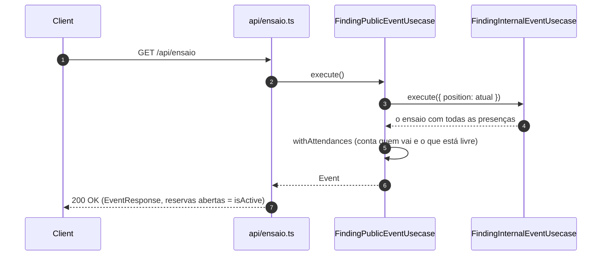

# Ensaio

> Atualizado em 2026-10-30.

## Ver o ensaio atual (FindingPublicEventUsecase) — `GET /api/ensaio`

**Telas.** Home (reservas abertas e fechadas), Instrumentos, Minhas reservas e a folha de reserva.

**Contexto.** Qualquer pessoa, sem se identificar, vê o próximo ensaio e o que ainda dá para
reservar.

**Desenho.** O ensaio vem de "Ver o ensaio com quem vai", em [`producao.md`](producao.md), que
também cria o ensaio vazio quando não há nenhum.

**Decisão.**
- O ensaio atual é o que a Produção deixou como atual: o último que ela liberou, ou o único que
  existe.
- Sem nenhum ensaio, cria o ensaio vazio padrão, igual ao da Produção, e ele passa a ser o atual.
- As reservas estão abertas quando a Produção liberou.
- Mostra local, data, horário, se as reservas estão abertas e o link do grupo.
- Mostra quantas pessoas vão, com e sem instrumento. Presença recusada não conta.
- Mostra quanto de cada instrumento e acessório ainda está livre. Item sem limite ou rotativo não
  mostra número.
- Não mostra quantas vagas sobram em cada grupo.

**Consequências.**
- O ensaio, as presenças e as pessoas chegam numa leitura só: a tela abre mais rápido.
- A conta das vagas é a mesma da Produção e da reserva, então as telas sempre batem.
- Com o banco vazio, aparece o ensaio vazio padrão, e não mais o último ensaio do Transicionais.
