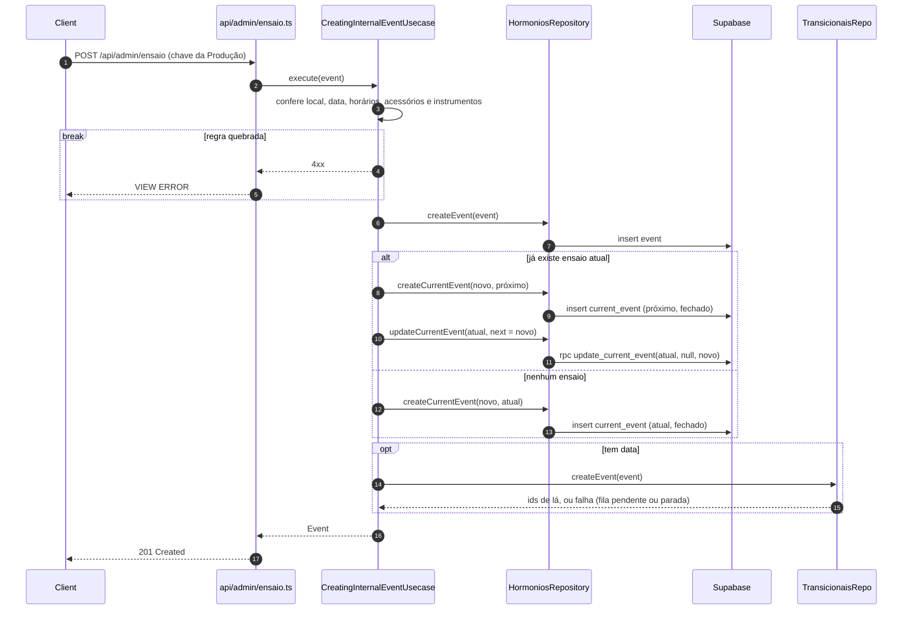
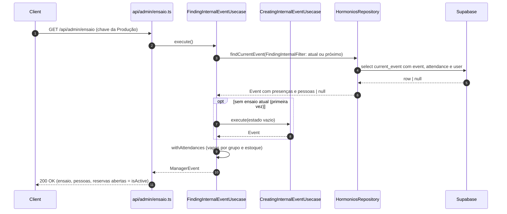
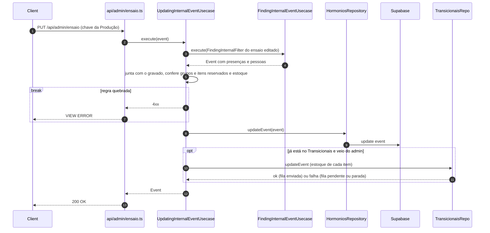
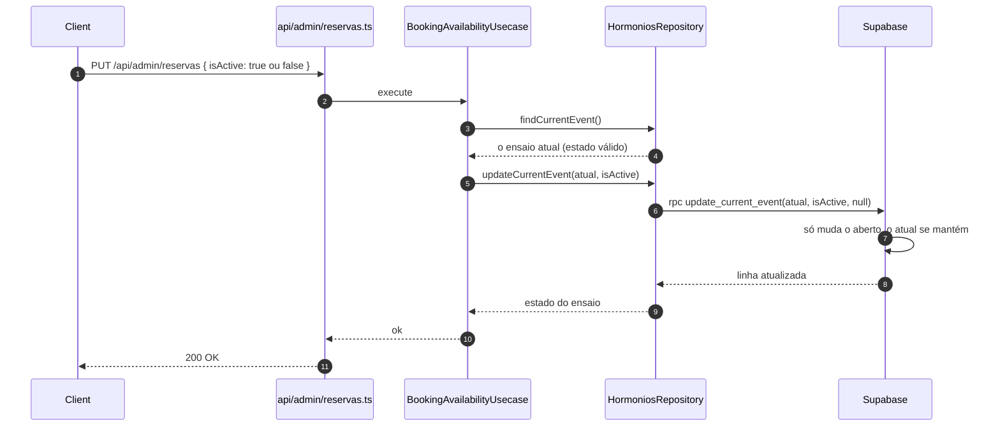
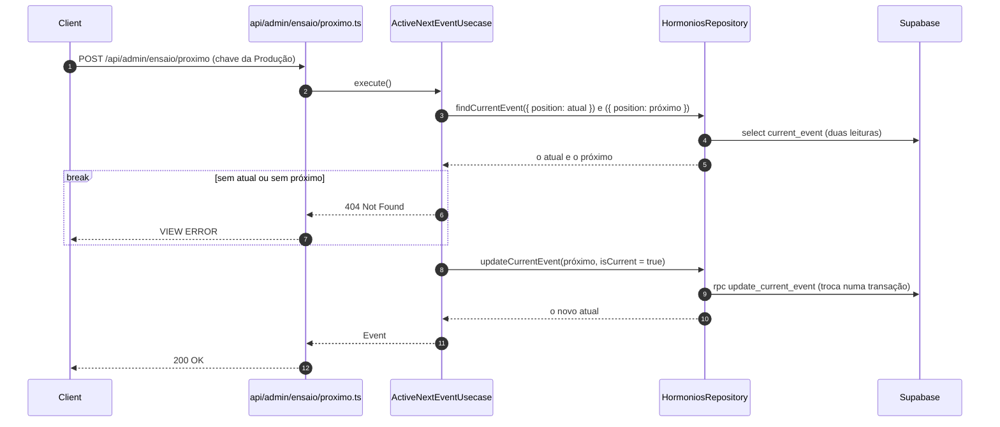

# Produção

> Atualizado em 2026-10-30. Só quem entrou com a chave da Produção usa estes usecases.

## Criar o próximo ensaio (CreatingInternalEventUsecase) — `POST /api/admin/ensaio`

**Telas.** Produção, ao salvar na aba PRÓXIMO. Também roda sem tela: na primeira
vez que a Produção abre, na primeira vez que a tela pública abre com o banco vazio e quando um
encontro novo chega do Transicionais.

**Contexto.** A Produção prepara o próximo ensaio.

**Desenho.**

**Decisão.**
- O ensaio precisa ter local, data e horários válidos, acessórios só de grupos do ensaio e no
  máximo um instrumento por grupo.
- O ensaio criado entra como o próximo, com as reservas fechadas e sem ninguém depois dele. O
  atual continua o atual.
- Quem troca o atual pelo próximo é o "Encerrar ensaio e criar próximo": o atual deixa de ser o
  atual, e o próximo passa a ser, com as reservas fechadas (`POST /api/admin/ensaio/proximo`, `ActiveNextEventUsecase`). Para encerrar, o
  próximo precisa já ter sido criado.
- Sem nenhum ensaio, o criado já é o atual.
- O ensaio novo começa sem nenhuma presença.
- O ensaio é enviado ao Transicionais com todos os grupos abertos para reserva. Sem data, o envio
  espera até ter.
- Lá, o nome do encontro leva o código do ensaio do Hormônios, para achar um no outro.

**Consequências.**
- Esta tela trata só o ensaio atual e o próximo. O histórico de ensaios fica no Transicionais.

## Ver o ensaio com quem vai (FindingInternalEventUsecase) — `GET /api/admin/ensaio`

**Telas.** Produção, ao abrir e depois de entrar com a chave. O título **ENSAIO** tem as abas
**ATUAL / PRÓXIMO**.

**Contexto.** A Produção acompanha o ensaio atual, quem vai, quem reservou o quê e o estoque, e
prepara o próximo.

**Desenho.** O ensaio vazio é criado por "Criar o próximo ensaio", acima.

**Decisão.**
- Mostra o ensaio atual com as pessoas e o que cada uma reservou.
- Mostra quantas vagas sobram em cada grupo, além do estoque de cada item.
- Instrumento zerado aparece com 0. O grupo sem instrumento cadastrado no Transicionais não mostra
  instrumento, e o grupo que não está na publicação do encontro lá não aparece.
- A aba ATUAL ou PRÓXIMO escolhe qual ensaio aparece: um de cada vez. O próximo aparece quando
  já foi criado.
- Sem próximo criado, a aba PRÓXIMO mostra o formulário vazio, já com a data do atual + 7 dias, o
  mesmo horário e o mesmo local. Salvar cria o próximo.
- Com `?debug=1`, mostra os ids do ensaio no Transicionais e no Hormônios.
- Na primeira vez, sem nenhum ensaio, cria um com os grupos e o catálogo padrão do Bloquinho, e
  ele passa a ser o atual. Se não conseguir, avisa que não encontrou.

**Consequências.**
- O ensaio, as presenças e as pessoas chegam numa leitura só.
- O projeto novo já abre com um ensaio pronto para a Produção ajustar.
- É o "ler" do ensaio: a tela pública e a edição usam esta mesma leitura.

## Editar o ensaio (UpdatingInternalEventUsecase) — `PUT /api/admin/ensaio`

**Telas.** Produção: "Salvar ensaio", "Salvar link" e o estoque −/+. Também roda sem tela, quando o
encontro muda no Transicionais.

**Contexto.** A Produção ajusta o ensaio: data, horário, local, link do grupo, grupos e estoque.

**Desenho.** O ensaio é lido por "Ver o ensaio com quem vai", acima.

**Decisão.**
- As mesmas regras da criação valem na edição.
- Lê o ensaio pela mesma leitura da Produção ("Ver o ensaio com quem vai").
- O que não foi informado fica como estava; o que veio em branco é apagado.
- Abrir e fechar as reservas não é mais feito aqui: é o "Liberar e fechar as reservas".
- Não dá para tirar um grupo ou item que alguém reservou.
- Não dá para baixar o estoque abaixo das reservas, a não ser num item rotativo.
- Mudanças vindas do Transicionais não mexem no link do grupo.
- O estoque editado aqui é enviado ao Transicionais. Se ele estiver fora do ar, tenta de novo
  depois.
- Quais grupos o ensaio tem e o cadastro dos instrumentos e acessórios são feitos no Transicionais
  e chegam aqui pela sincronização.

**Consequências.**
- Uma mudança do Transicionais que quebra essas regras é recusada.

## Liberar e fechar as reservas (BookingAvailabilityUsecase) — `PUT /api/admin/reservas`

**Telas.** Produção: "Liberar reservas" e "Fechar reservas", na aba ATUAL.

**Contexto.** A Produção abre e fecha as reservas sem mexer nos dados do ensaio.

**Desenho.**

**Decisão.**
- Só um ensaio tem reservas abertas por vez.
- Liberar e fechar valem sempre para o ensaio atual. O próximo não é liberado por aqui.
- Fechar as reservas mantém o ensaio como atual: a tela pública e a Produção continuam mostrando
  ele.
- O ensaio atual só muda no "Encerrar ensaio e criar próximo".
- As mudanças são feitas uma de cada vez, então dois cliques ao mesmo tempo não deixam o estado
  errado.

**Consequências.**
- Abrir e fechar não depende de editar o ensaio nem de criar o próximo.
- O ensaio não encerra sozinho depois da data
  ([issue #19](https://github.com/brubriele/hormonios-garoa/issues/19)).

## Encerrar o ensaio e passar para o próximo (ActiveNextEventUsecase) — `POST /api/admin/ensaio/proximo`

**Telas.** Produção, no botão "Encerrar ensaio e criar próximo".

**Contexto.** Ao fim de um ensaio, a Produção passa para o próximo, que já foi criado na aba
PRÓXIMO.

**Desenho.**

**Decisão.**
- Só encerra se o próximo já foi criado.
- O próximo passa a ser o atual, com as reservas fechadas. O anterior deixa de aparecer.
- A troca é feita de uma vez, então dois cliques ao mesmo tempo não deixam o estado errado.

**Consequências.**
- Esta tela trata só o ensaio atual e o próximo. O histórico de ensaios fica no Transicionais.
