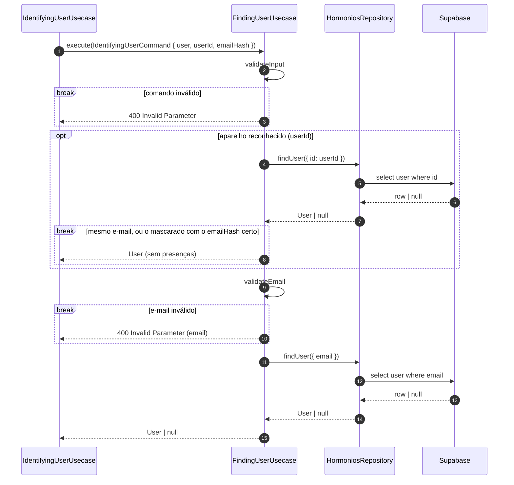
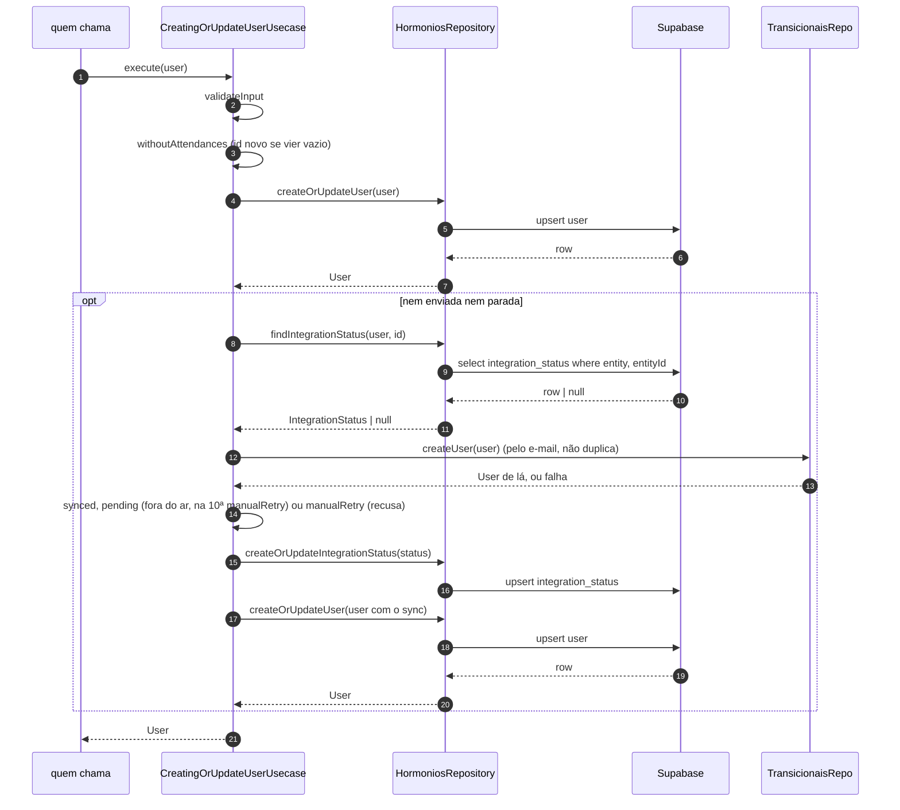
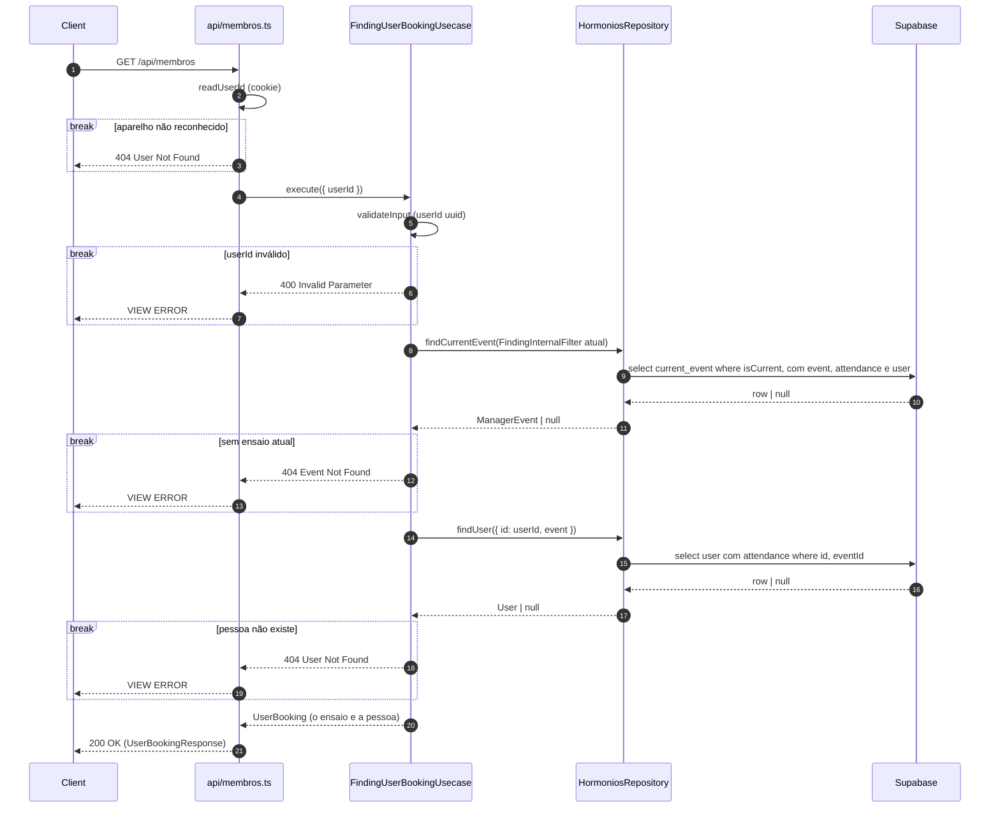
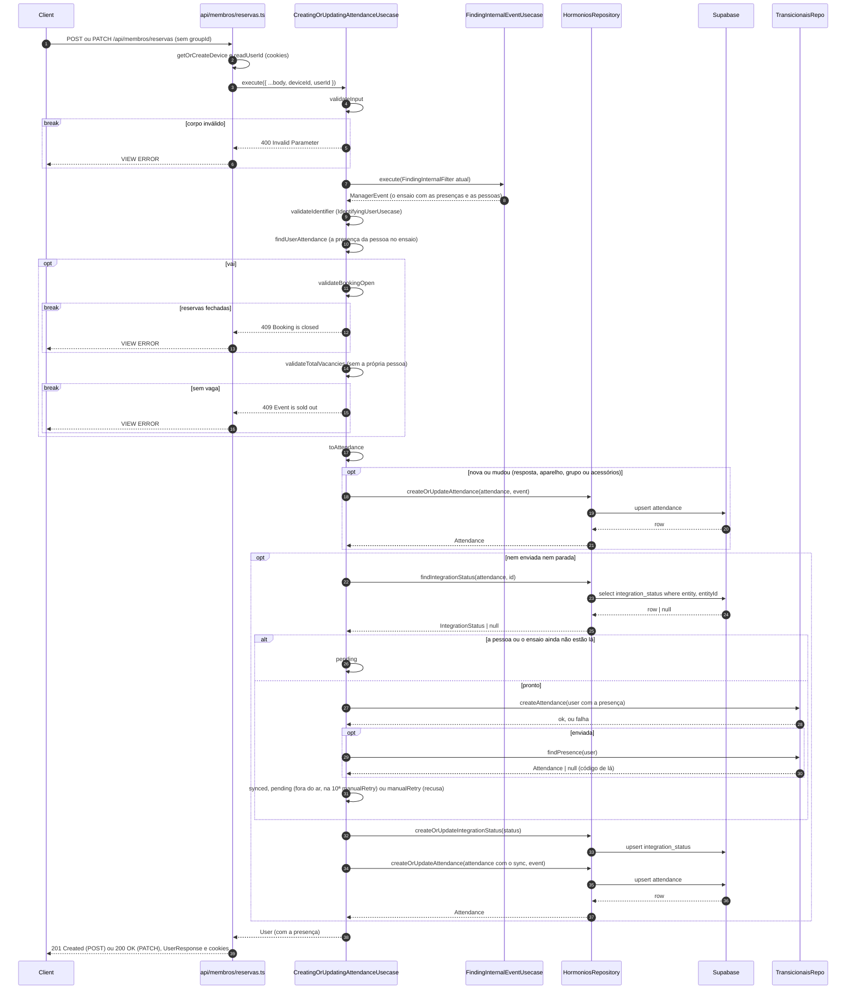
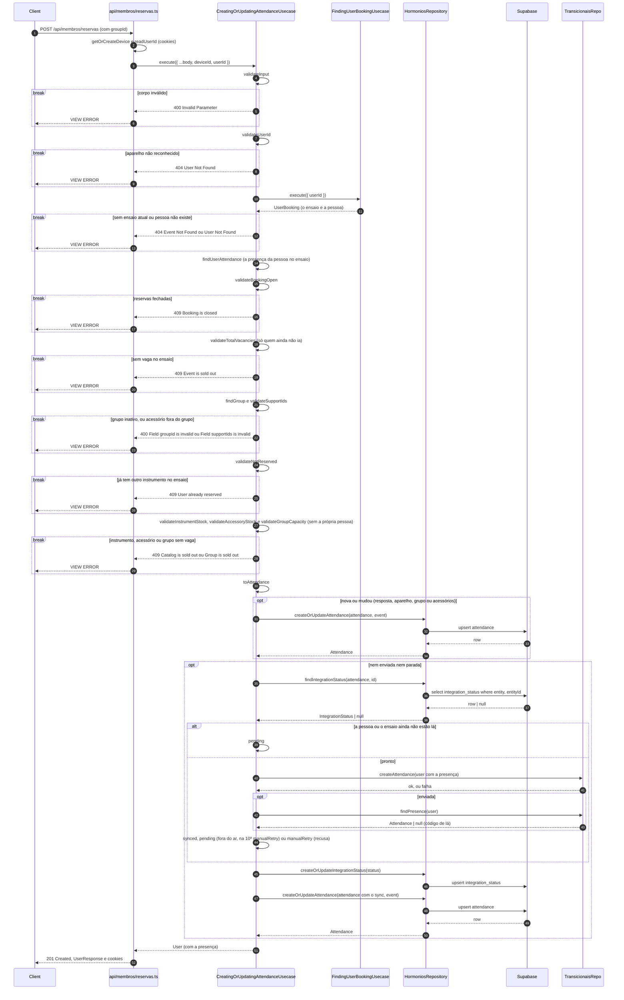

# Reservas

> Atualizado em 2026-10-30. A reserva é a presença da pessoa no ensaio atual, com ou sem
> instrumento.

## Descobrir quem está reservando (FindingUserUsecase) — sem rota

**Telas.** Nenhuma diretamente: roda dentro de "Identificar quem está reservando"
([`autenticacao.md`](autenticacao.md)).

**Contexto.** Acha a pessoa que já existe, se existir.

**Desenho.**

**Decisão.**
- Se o aparelho é reconhecido e o e-mail é o da pessoa (o completo, ou o mascarado que a tela
  mostrou), é ela.
- Senão, procura pelo e-mail, que precisa ser válido.

**Consequências.**
- Lê só a pessoa: as presenças vêm do ensaio.

## Gravar a pessoa (CreatingOrUpdateUserUsecase) — sem rota

**Telas.** Nenhuma diretamente: roda dentro de "Identificar quem está reservando" e quando uma
pessoa chega do Transicionais.

**Contexto.** A pessoa precisa estar cadastrada aqui e no Transicionais.

**Desenho.**

**Decisão.**
- Grava a pessoa e a cadastra no Transicionais. Não confere se mudou: quem chama decide.

**Consequências.**
- Uma pessoa que chega do Transicionais é gravada sempre.

## Ver as minhas reservas (FindingUserBookingUsecase) — `GET /api/membros`

**Telas.** Minhas reservas; a Presença e a folha de reserva, que já vêm preenchidas.

**Contexto.** A pessoa vê a própria reserva do ensaio atual. É também a leitura que a reserva de
instrumento usa.

**Desenho.**

**Decisão.**
- Só o aparelho reconhecido vê as próprias reservas.
- Não compara o e-mail: o aparelho basta.

**Consequências.**
- O e-mail inteiro nunca aparece na tela.

## Confirmar presença ou desfazer (CreatingOrUpdatingAttendanceUsecase) — `POST /api/membros/reservas` e `PATCH /api/membros/reservas`

**Telas.** Presença ("Confirmar presença"), Minhas reservas ("Desfazer") e o começo da folha de
reserva, quando a pessoa ainda não é reconhecida.

**Contexto.** A pessoa diz que vai ao ensaio, só com a presença, ou que não vai.

**Desenho.** A pessoa vem de "Identificar quem está reservando" ([`autenticacao.md`](autenticacao.md)),
e o ensaio, de "Ver o ensaio com quem vai" ([`producao.md`](producao.md)).

**Decisão.**
- Identifica a pessoa pelo aparelho, pelo e-mail ou pelo e-mail mascarado, e reconhece o aparelho.
- Cada pessoa tem uma presença por ensaio. Uma nova resposta substitui a anterior, e só é gravada
  quando mudou.
- Para ir, as reservas precisam estar abertas e precisa haver vaga no ensaio.
- Desfazer o instrumento mantém a presença. Desfazer a presença vira "não vou".
- "Não vou" vale mesmo com as reservas fechadas.
- A presença é enviada ao Transicionais.

**Consequências.**
- "Não vou" é uma resposta; "nem vi" é não ter resposta.
- Quem usa o e-mail de outra pessoa passa a ser ela, até existir login por e-mail.

## Reservar instrumento (CreatingOrUpdatingAttendanceUsecase) — `POST /api/membros/reservas`

**Telas.** A folha de reserva ("Reservar instrumento").

**Contexto.** A pessoa reconhecida escolhe um instrumento e os acessórios dele.

**Desenho.** O ensaio e a pessoa vêm de "Ver as minhas reservas", acima. Quem chega sem ser
reconhecido passa antes por "Confirmar presença ou desfazer", acima.

**Decisão.**
- Exige o aparelho reconhecido e não confere o e-mail de novo.
- Quem vai direto ao instrumento, sem ter confirmado presença, passa primeiro pela presença.
- O grupo precisa estar ativo, os acessórios precisam valer para o grupo, a pessoa não pode ter
  outro instrumento no ensaio, e precisa haver vaga no instrumento, nos acessórios e no grupo.
- As vagas são contadas sem a própria pessoa, então ela pode trocar os acessórios.

**Consequências.**
- A pessoa é lida uma vez em cada chamada.
- Num aparelho reconhecido, o instrumento vai para a pessoa desse aparelho, mesmo que outra pessoa
  digite outro e-mail na folha.
