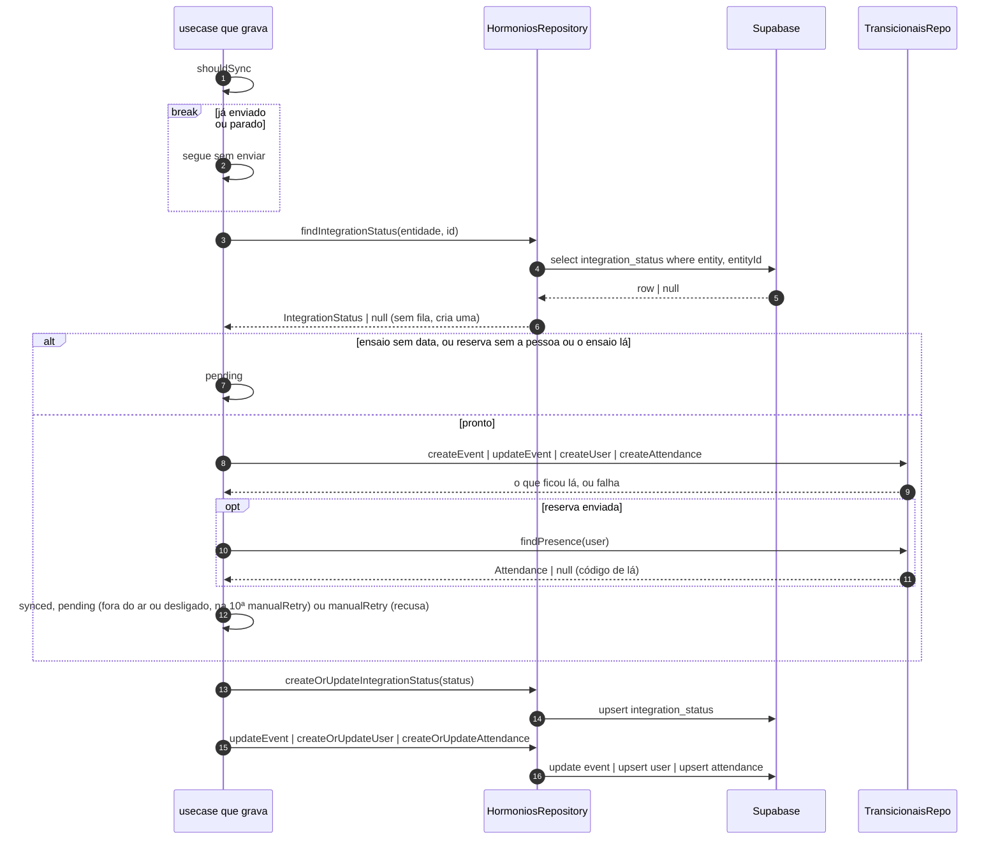
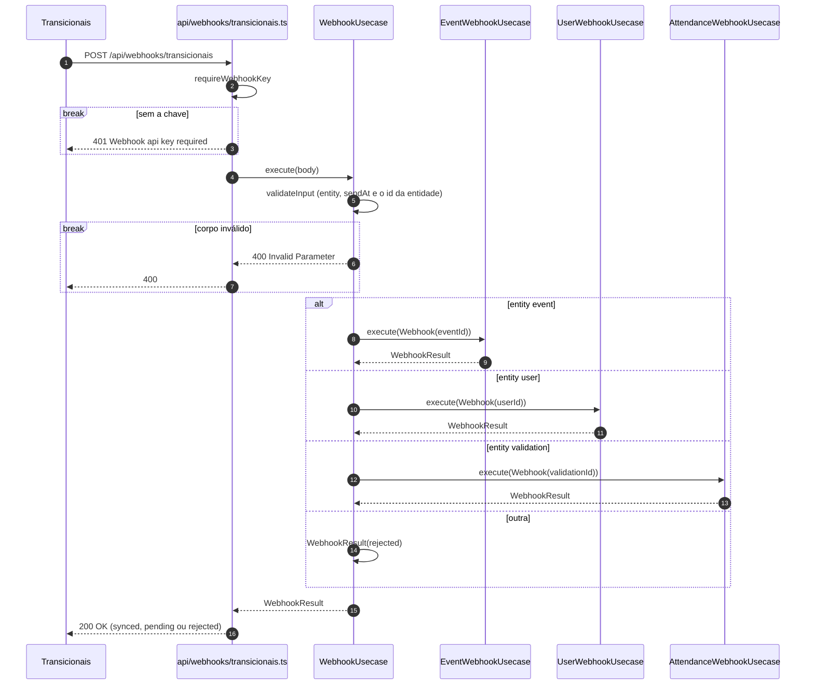
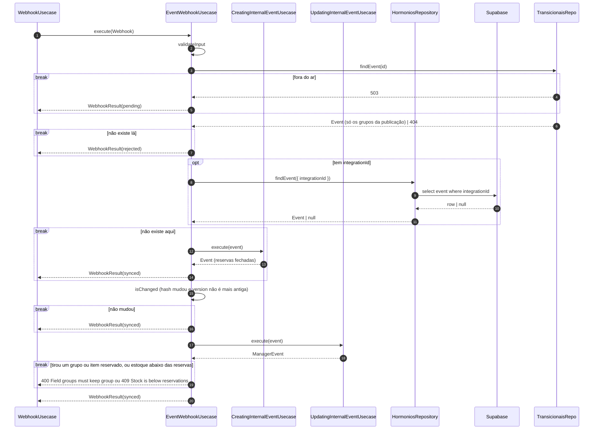
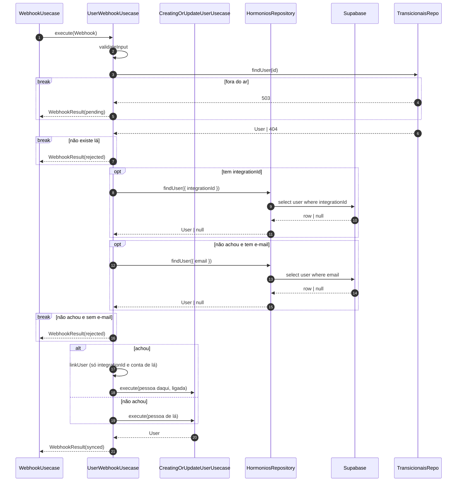
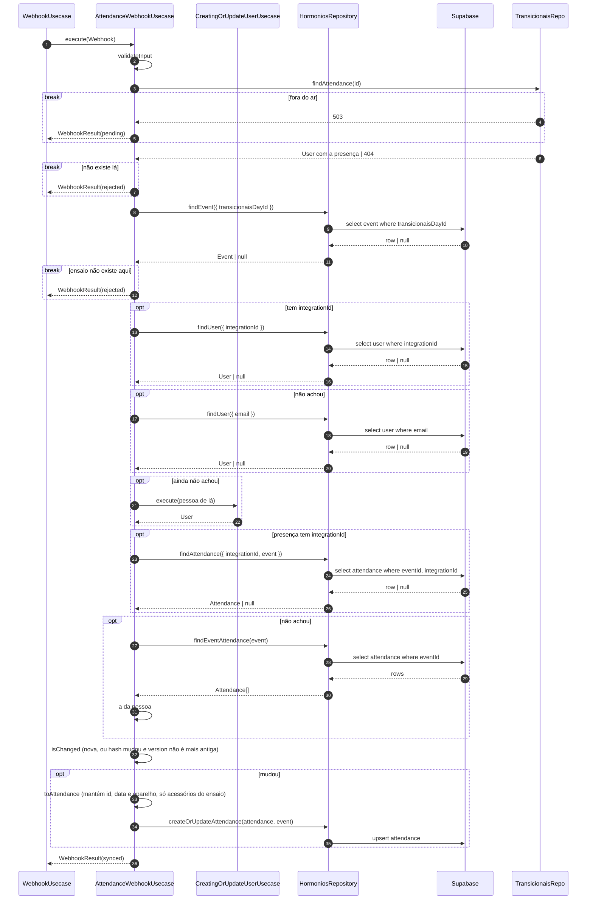
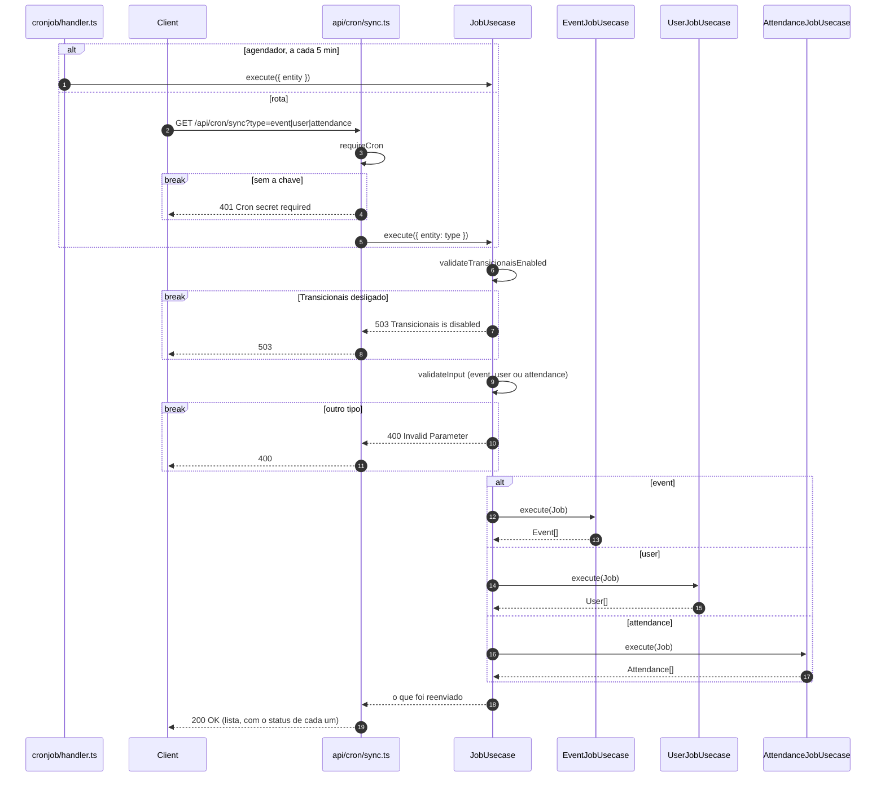
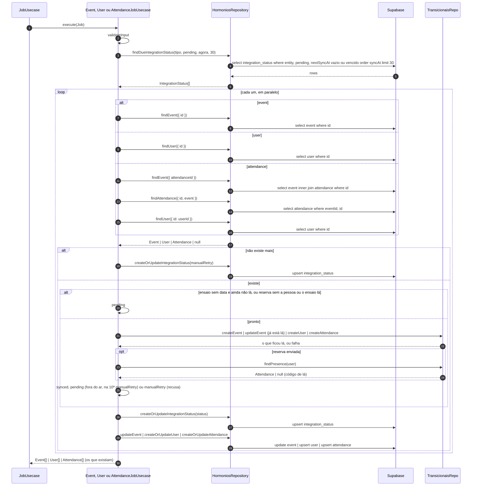

# Sincronização

> Atualizado em 2026-10-29. O ensaio, as pessoas e as presenças ficam iguais no Transicionais: o
> que muda aqui é enviado para lá, e o que muda lá é trazido para cá.

## Envio — dentro de criar ensaio, gravar pessoa e reservar

**Telas.** As mesmas desses usecases. O envio não aparece na tela.

**Contexto.** Criar um ensaio, editar o estoque, gravar uma pessoa ou uma reserva precisa chegar ao Transicionais,
sem fazer a tela esperar nem falhar.

**Desenho.**

**Decisão.**
- Logo depois de gravar, o sistema envia.
- Se o Transicionais estiver fora do ar, tenta de novo depois de 1, 5, 15 e então a cada 60
  minutos. Na 10ª tentativa, para e espera alguém.
- Se o Transicionais recusar, para e espera alguém, com o motivo guardado.
- Com o Transicionais desligado de propósito na configuração, o envio fica pendente na hora, sem
  esperar por ele. Ao religar, o reenvio automático manda o que ficou pendente.
- Enquanto o ensaio não tem data, ou a pessoa ou o ensaio ainda não chegaram lá, a reserva espera
  para ser enviada.
- A reserva com grupo leva o instrumento do grupo e os acessórios escolhidos.
- Depois de enviada, a reserva guarda o código que ela ganhou no Transicionais.

**Consequências.**
- A tela responde igual com ou sem o Transicionais.
- O que parou precisa de alguém para olhar o motivo e mandar de novo.

## Receber um aviso do Transicionais (WebhookUsecase) — `POST /api/webhooks/transicionais`

**Telas.** Nenhuma: quem chama é o Transicionais. O resultado aparece nas telas que mostram o
ensaio e as reservas.

**Contexto.** O Transicionais avisa que um encontro, uma pessoa ou uma presença mudou.

**Desenho.**

**Decisão.**
- Só aceita aviso com a chave combinada.
- Encaminha o aviso conforme o que mudou: encontro, pessoa ou presença. Outro tipo é recusado.
- Responde se aceitou e como ficou: igual, pendente (o Transicionais estava fora do ar) ou
  recusado.

**Consequências.**
- O mesmo aviso repetido não causa problema, porque só grava o que mudou.

## Trazer um encontro alterado (EventWebhookUsecase) — sem rota

**Telas.** Nenhuma: o ensaio aparece na Home e na Produção.

**Contexto.** Um encontro foi criado ou alterado no Transicionais.

**Desenho.**

**Decisão.**
- Se o encontro não existe lá, recusa.
- Se o ensaio ainda não existe aqui, cria. Se existe e mudou, atualiza. Uma versão mais antiga que
  a guardada é ignorada.
- O link do grupo e a abertura das reservas não mudam por esse aviso.
- Só entram os grupos que estão na publicação do encontro lá. O instrumento de cada grupo vem do
  cadastro dele no Transicionais; o grupo sem esse cadastro fica sem instrumento.

**Consequências.**
- As regras de criar e editar o ensaio também valem aqui: um encontro que tira um grupo com reserva
  é recusado.

## Trazer uma pessoa alterada (UserWebhookUsecase) — sem rota

**Telas.** Nenhuma: a pessoa aparece em Minhas reservas e na Produção.

**Contexto.** Uma pessoa foi cadastrada ou alterada no Transicionais.

**Desenho.**

**Decisão.**
- Se a pessoa não existe lá, recusa.
- Procura a pessoa aqui pela conta ou pelo e-mail.
- Se não existe, cria; sem e-mail, recusa.
- Se existe, só liga a pessoa à conta. Nome, e-mail e pronome não mudam.

**Consequências.**
- Quem reservou não tem o nome trocado por esse aviso.

## Trazer uma presença alterada (AttendanceWebhookUsecase) — sem rota

**Telas.** Nenhuma: a presença aparece em Minhas reservas, nas vagas da Home e de Instrumentos e
na Produção.

**Contexto.** Uma presença foi criada ou alterada no Transicionais.

**Desenho.**

**Decisão.**
- Se a presença não existe lá, ou o ensaio dela não existe aqui, recusa.
- Acha a pessoa ou a cria.
- Grava a presença quando é nova ou mudou, mantendo a data em que foi feita e o aparelho.
- Dos acessórios, ficam só os que o ensaio oferece.
- Não confere vaga nem prazo: a presença já foi aceita lá.

**Consequências.**
- A presença trazida não é enviada de volta.

## Reenviar o que ficou pendente (JobUsecase) — `GET /api/cron/sync?type=event|user|attendance` e agendador

**Telas.** Nenhuma: quem chama é o agendador da Cloudflare, a cada 5 minutos, ou alguém pela rota.

**Contexto.** O que não chegou ao Transicionais precisa ser enviado de novo, sem ninguém pedir.

**Desenho.**

**Decisão.**
- O agendador roda sozinho a cada 5 minutos, um horário para cada tipo. Pela rota, só aceita a
  chamada com a chave combinada.
- Recebe o que reenviar: ensaios, pessoas ou presenças. Outro tipo é recusado.
- Com o Transicionais desligado de propósito na configuração, não reenvia nada e avisa que ele
  está fora do ar.
- Responde a lista do que foi reenviado, com o resultado de cada um.

**Consequências.**
- Cada tipo é chamado separado, então um tipo com problema não atrasa os outros.
- Enquanto o Transicionais está desligado, as tentativas não contam: o que ficou pendente não
  para por excesso de tentativas.
- Cada rodada deixa registrado o que aconteceu com cada item e um resumo, para o time conferir.

## Reenviar ensaios, pessoas ou presenças (EventJobUsecase, UserJobUsecase e AttendanceJobUsecase) — sem rota

**Telas.** Nenhuma: quem chama é o reenvio acima.

**Contexto.** Cada um reenvia os pendentes de um tipo.

**Desenho.**

**Decisão.**
- Pega os pendentes cuja nova tentativa já está na hora, os mais antigos primeiro, até 30 por vez.
- Envia cada um com as mesmas regras do **Envio**. Um que falha não para os outros.
- O que não existe mais aqui para e espera alguém.
- O ensaio que já está no Transicionais não é criado de novo: só a edição do estoque é reenviada.

**Consequências.**
- O que parou para alguém olhar não volta sozinho.
